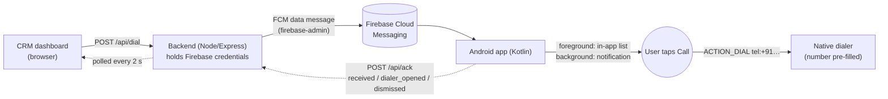

# LeadZam Click-to-Call

Click **Call** on a lead in a browser CRM → a small backend sends a Firebase Cloud Messaging (FCM) message → an Android app receives it → the user taps **Call** on the phone → the **native dialer opens with the number pre-filled**. Nothing is ever dialed automatically.



The browser never sees Firebase credentials. Only the backend can send FCM messages.

## Repository layout

| Path | What it is |
|---|---|
| `web/` | CRM dashboard: plain HTML/CSS/JS, served by the backend (no build step) |
| `backend/` | Node.js + Express API, `firebase-admin` sender, tests (`node --test`) |
| `android/` | Kotlin Android app (FCM service, notification, dialer launch, unit tests) |
| `docs/REQUIREMENTS_QA.md` | Every requirement from the assignment PDF mapped to what was built |
| `docs/INTERVIEW_PREP.md` | Walk-through of the flow and likely follow-up questions |
| `scripts/check-secrets.sh` | Fails if a key or credential file is about to be committed |

## Prerequisites

- Node.js 18+ (developed on 22)
- Android Studio (Ladybug or newer) with an emulator **with Google Play services**, or a physical Android phone (Android 7.0+, API 24+)
- A free Firebase project

## 1. Firebase setup (one time)

1. [Firebase console](https://console.firebase.google.com) → create a project. Cloud Messaging is on by default.
2. **Project settings → Your apps → Add app → Android.** Package name: `com.leadzam.clicktocall`. Download `google-services.json` and save it as `android/app/google-services.json` (git-ignored).
3. **Project settings → Service accounts → Generate new private key.** Save the file as `backend/secrets/service-account.json` (git-ignored). This is a server secret. Never put it in the web app, the Android app or git.

## 2. Run the backend and dashboard

```bash
cd backend
npm install
cp .env.example .env        # defaults already point at ./secrets/service-account.json
npm start                   # http://localhost:3000
```

No Firebase project yet? `npm run start:mock` runs the whole dashboard with a fake sender (logs instead of calling FCM). Registering a token that starts with `invalid` or `unregistered` simulates the two most common FCM failures.

## 3. Run the Android app

1. Open the `android/` folder in Android Studio and let Gradle sync (the wrapper downloads Gradle 8.9).
2. Run the `app` configuration on an emulator or device. Accept the notification permission prompt (Android 13+).
3. In the app, set **Backend URL**:
   - Emulator: `http://10.0.2.2:3000` (default, the emulator's alias for your laptop).
   - Physical phone: `http://<your-laptop-LAN-IP>:3000` on the **same Wi-Fi** (the backend prints it on startup; allow Node through your firewall).
4. Tap **Register with backend**. The dashboard's "Android device" banner turns green.
   Alternative: tap **Copy token**, paste it into *Register a device manually* on the dashboard.

Release builds block cleartext HTTP (Android's default). Only the debug build allows `http://` (`android/app/src/debug/AndroidManifest.xml`), which is what the demo uses.

## 4. Demo script (what the video shows)

1. Dashboard open, device banner green.
2. Click **Call** on *Rahul Sharma*: button shows *Sending…*, then *Request accepted by FCM*.
3. **Background case:** phone in the home screen or another app. A heads-up notification *"Call request from CRM: Rahul Sharma · +919876543210"* appears. Tap **Call** → dialer opens with `+919876543210`. Dashboard turns to *Dialer opened on the phone*.
4. **Foreground case:** with the app open, click Call again. The request appears at the top of the in-app list with a snackbar and **no** notification. Tap **Call** on the card.
5. Click **Call** on *Anita Verma* (deliberately malformed number): dashboard shows a validation error and nothing is sent.

## API

| Method & path | Purpose |
|---|---|
| `POST /api/dial` `{phoneNumber, contactName?}` | Validate, send FCM message. `202` accepted · `400` validation · `409` no device · `410` token unregistered · `502/503` FCM problem |
| `POST /api/device` `{token, deviceName?}` | Register the demo device (the Android app calls this) |
| `GET /api/device` · `DELETE /api/device` | Show (masked) / forget the device |
| `POST /api/ack` `{requestId, status}` | Android → backend: `received` · `dialer_opened` · `dismissed` |
| `GET /api/requests` | Recent call requests with status (dashboard polls this) |
| `GET /api/leads` · `GET /api/health` | Sample leads / health |

Errors always look like `{ "error": { "code": "...", "message": "...", "fields"?: {...}, "retryable"?: bool } }`.

### FCM payload

```json
{
  "token": "<device token>",
  "data": {
    "type": "dial_request",
    "requestId": "b3b1…",
    "phoneNumber": "+919876543210",
    "contactName": "Rahul Sharma",
    "sentAt": "2026-10-14T11:22:37.000Z"
  },
  "android": { "priority": "high", "ttl": 300000 }
}
```

## Design decisions (the "why")

- **Data-only message, no `notification` block.** With a `notification` block, Android's system tray shows it by itself when the app is in the background and *our code does not run*. We could not add a **Call** action, de-duplicate, or record the request. A data message always reaches `FirebaseMessagingService.onMessageReceived`, so the app decides the experience.
- **`priority: high`** so delivery is prompt under Doze. **`ttl: 5 min`** because "call this lead now" is useless an hour later. FCM drops stale requests instead of delivering them later. **No `collapse_key`**, so two different leads clicked in a row are both delivered.
- **Foreground vs background.** `MainActivity.onStart/onStop` flips `AppForeground.isVisible`. In the foreground the request shows in the in-app list (plus snackbar). In the background we post a notification. We never launch an activity over the user: Android 10+ forbids it from the background, and it is bad UX anyway.
- **Notification "Call" action → invisible `DialTrampolineActivity` → `ACTION_DIAL`.** The hop lets us record `dialer_opened` and ack the backend before the dialer opens. An *activity* trampoline is allowed on Android 12+. Only receiver/service trampolines are blocked.
- **`ACTION_DIAL`, not `ACTION_CALL`.** The user presses the green button. No `CALL_PHONE` permission needed, and an automatic call is impossible by construction.
- **FCM data is untrusted on the device.** The backend validates, and the app validates again: only digits and a leading `+` survive, so a forged payload cannot push a USSD/MMI code (`*#06#`, `*21*…#`) into the dialer.
- **Honest status wording.** FCM accepting a message ≠ delivery. The dashboard says *Request accepted by FCM* and only says *Received by the phone* after the app sends an ack.
- **Acks are best-effort and forward-only.** A late `received` can never overwrite `dialer_opened`. If the backend is unreachable the call flow itself still works.

## Edge cases

| Case | Behaviour |
|---|---|
| Empty / invalid phone number | Backend `400` with per-field message; dashboard shows it; nothing sent. App re-validates incoming data. |
| No device registered | `409 NO_DEVICE` with instructions |
| Token invalid / unregistered | FCM error mapped to `400`/`410`, stored token is forgotten, dashboard asks to re-register |
| FCM down, rate limited or hanging | `503` (retryable) or `502`. Sends time out after 10 s so the UI never hangs |
| Missing server credentials | `503 FCM_NOT_CONFIGURED` with a clear message (and a startup warning) |
| Backend unreachable from the browser | Dashboard shows "Could not reach the CRM backend" |
| App open vs background | In-app list + snackbar vs notification (see above) |
| App killed (swiped away) | High-priority data message still starts the service; notification is posted |
| App force-stopped in system settings | Android blocks FCM until the user opens the app again (platform behaviour, documented limitation) |
| Notifications permission denied | Request is still stored and shown in the app; the app shows a warning banner |
| User dismisses / ignores | Swipe → marked *Dismissed* (ack sent). Ignored requests stay in the list, still callable. FCM drops undelivered ones after 5 min |
| Several requests | Each has its own `requestId`, notification and list card; Android groups them under a summary. Duplicate deliveries are ignored by `requestId` |
| No dialer app on device | Toast "No dialer app was found"; request is *not* marked as opened |

## Testing

```bash
cd backend && npm test                      # 22 tests: validation, API, FCM error mapping, acks, timeouts
cd android && ./gradlew testDebugUnitTest   # DialRequest parsing/sanitising, backend-URL validation
```

- **Backend (22 tests, passing):** validation incl. USSD rejection, data-only/high-priority payload, normalized number, no-device, unregistered/invalid token, generic failure, hanging FCM, missing credentials, forward-only acks, concurrent requests, malformed JSON.
- **End-to-end smoke test of the backend** (mock FCM): health, static dashboard, register, dial, validation error, acks, unregistered-token path.
- **Android unit tests:** payload parsing, USSD/MMI rejection, name cleaning, JSON round trip, backend URL validation. The parsing/validation logic was compiled with `kotlinc` and its tests run green on the JVM during development. Android-framework code (service, notification, activities) needs a device.
- **Manual device checklist** (run these on your phone and tick them off before recording the video):
  - [ ] Foreground: request shows in the list, snackbar, no notification
  - [ ] Background (home screen): heads-up notification, **Call** opens dialer with the exact number
  - [ ] Killed (swiped from recents): notification still arrives
  - [ ] Two requests in a row: two notifications/cards, both callable
  - [ ] Swipe a notification away: dashboard shows *Dismissed on the phone*
  - [ ] Notifications denied: warning banner, request still in the list
  - [ ] Phone offline for >5 min: stale request is not delivered later
  - [ ] Unregistered token (uninstall + reinstall without re-registering): dashboard shows the 410 message
  - [ ] Dashboard "Anita Verma" (invalid number): validation error

## Assumptions, shortcuts and known limitations

- One demo device, in memory plus a git-ignored `backend/data/device.json`. No login, no multi-tenant model.
- `POST /api/device` and `/api/ack` are unauthenticated (demo only). Anyone who can reach the server could re-point the demo device. Production needs auth (see below).
- Acks are fire-and-forget with no retry queue. If the process dies right after a swipe, that ack can be lost.
- Request history is in memory (50 most recent) and resets when the server restarts.
- Dashboard polls every 2 s instead of using SSE/WebSocket, to keep it simple.
- The relative time in the Android list refreshes on screen open/changes, not live.
- Leads are mock data in `backend/src/leads.js`.
- `usesCleartextTraffic` is enabled for **debug builds only**.

## If this went to production

- **Multiple devices:** a `devices` table (`userId, deviceId, fcmToken, name, lastSeen`). Dial targets a chosen device (or all via `sendEach`), and tokens that FCM reports as unregistered are pruned. The device picker lives in the CRM.
- **Dual-SIM:** list call-capable accounts with `TelecomManager.getCallCapablePhoneAccounts()` (needs `READ_PHONE_STATE`), let the user pick a default SIM, and pass `TelecomManager.EXTRA_PHONE_ACCOUNT_HANDLE` on the dial intent. Honouring it varies by dialer, so it needs testing across OEMs.
- **Auth & hardening:** per-user auth on all endpoints, signed device registration, rate limiting, https everywhere, secrets in a secret manager.
- **Reliability:** ack retry via WorkManager, SSE for live status, request expiry on the CRM side.
- **Android:** instrumented/UI tests (Espresso + a fake `RemoteMessage`), `adb`-driven FCM tests in CI.

## AI Usage Notes

> These notes must describe what *you* actually did. Edit anything that is not true for you, and fill in the marked item before submitting.

- **Which AI tools did you use?** Claude (Claude Code) to scaffold and write the backend, dashboard, Android app, tests and docs.
- **Where did AI help you most?** Producing the whole pipeline quickly (Express API with firebase-admin error mapping, the FCM service / notification / trampoline wiring, test suites), and enumerating edge cases (TTL, collapse key, Doze priority, Android 12 trampoline rules, Android 13 notification permission, USSD injection).
- **One AI suggestion you changed, rejected or improved, and why:** **[TODO – write your own genuine example after reviewing the code.]** Candidates that are real in this codebase: (a) Acks are fire-and-forget; you could replace this with a WorkManager retry. (b) `NotificationDismissReceiver` marks a request dismissed on swipe — you may disagree and decide a swipe should not change state. (c) The dashboard polls every 2 s — you might switch to SSE. (d) The unauthenticated `/api/device` — add a shared-secret header. Make the change, test it, then describe what you changed and why.
- **What would you improve with another two hours?** Auth on `/api/device` and `/api/ack`; WorkManager-backed ack retries; an `adb`/instrumented test that injects a fake `RemoteMessage`; SSE instead of polling; a device picker for multiple phones; dual-SIM selection.
